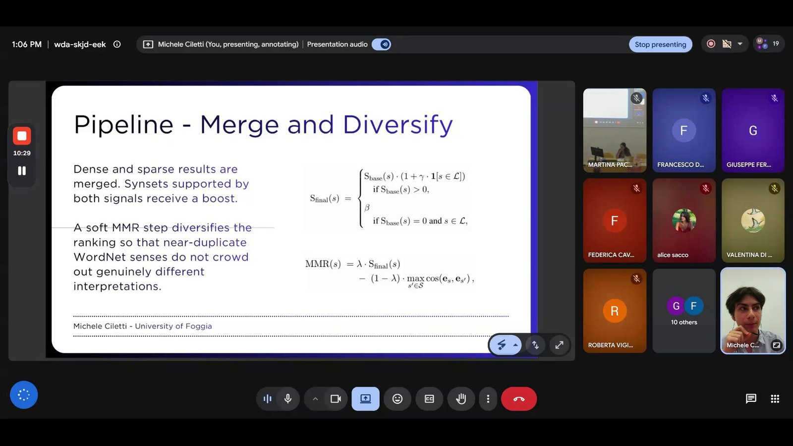

I had a wonderful experience at Digital Latin III, the workshop on digital tools and AI for research on the Latin lexicon organised by the University of Siena (15-16 June 2026)! It was a truly innovative conference and an amazing scientific environment: the program went from medieval glossaries and the digital edition of the *Dictionary of Medieval Latin from British Sources* to transformer models trained on Latin.

I presented some preliminary findings on open-vocabulary, LLM-based Word Sense Disambiguation, aimed mainly (but not only) at historical languages. Most WSD systems choose a sense from a list of candidates that a lexical resource already provides for the target word; for Latin, that list is often incomplete or missing altogether. The pipeline I presented, Inspicio, does without it. An LLM translates the Latin sentence into English twice, once literally and once more naturally, and then proposes English substitute lemmas and dictionary-style definitions for the target word. These are used to search all the verb synsets of the Open English WordNet, combining dense similarity between definitions and synsets with sparse matching on the lemmas. Synsets found by both methods get a boost, and a final Maximal Marginal Relevance step makes sure that near-duplicate WordNet senses do not push genuinely different interpretations out of the ranking.

On Latin perception verbs and a selection of sentences from LatinISE, the best combination of LLM and embedding model reached 90% Recall@20. These are still early numbers. The next steps are adding an LLM reranker, testing smaller open-weight models, going beyond verbs, and trying the same approach on other historical languages.

The code is [on GitHub](https://github.com/MikCil/inspicio). Check out the [workshop page](https://centroideugsu.unisi.it/2026/03/05/digital-latin-iii/) too: the proceedings are coming soon!

