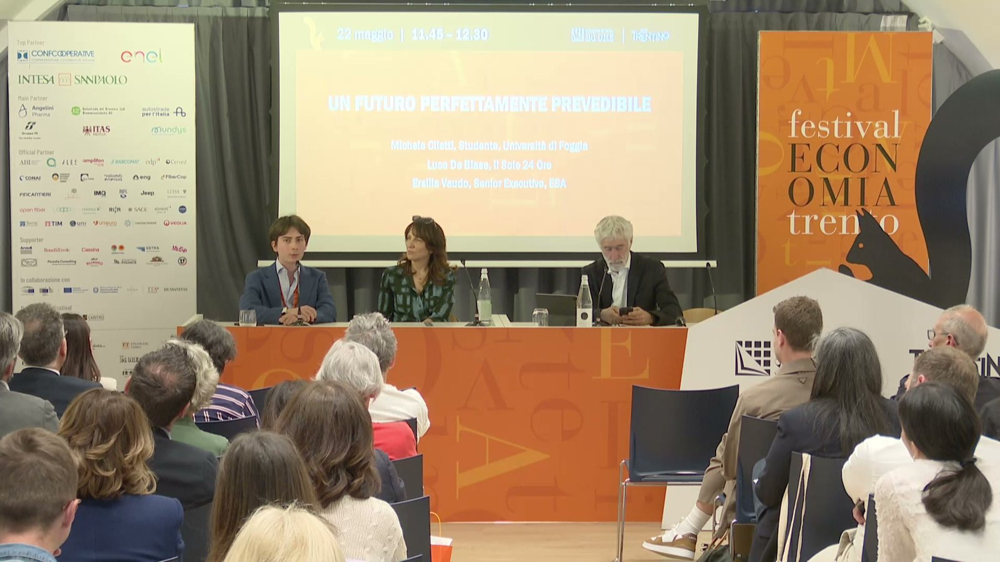
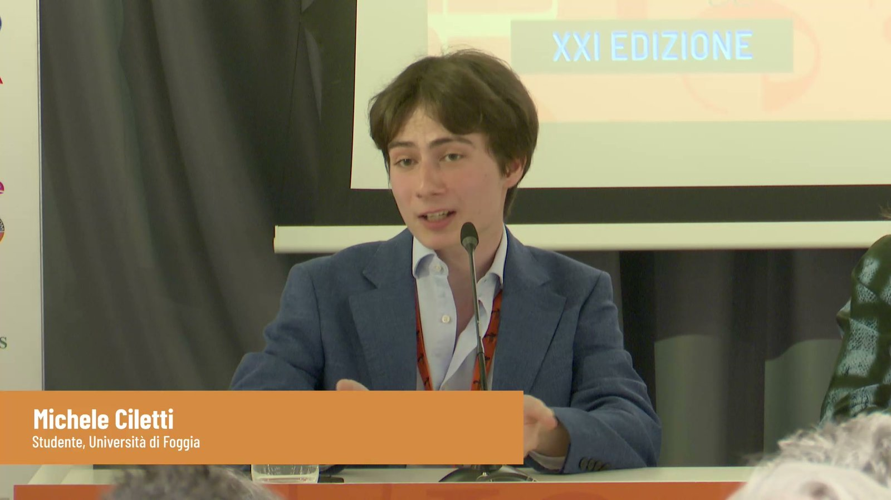
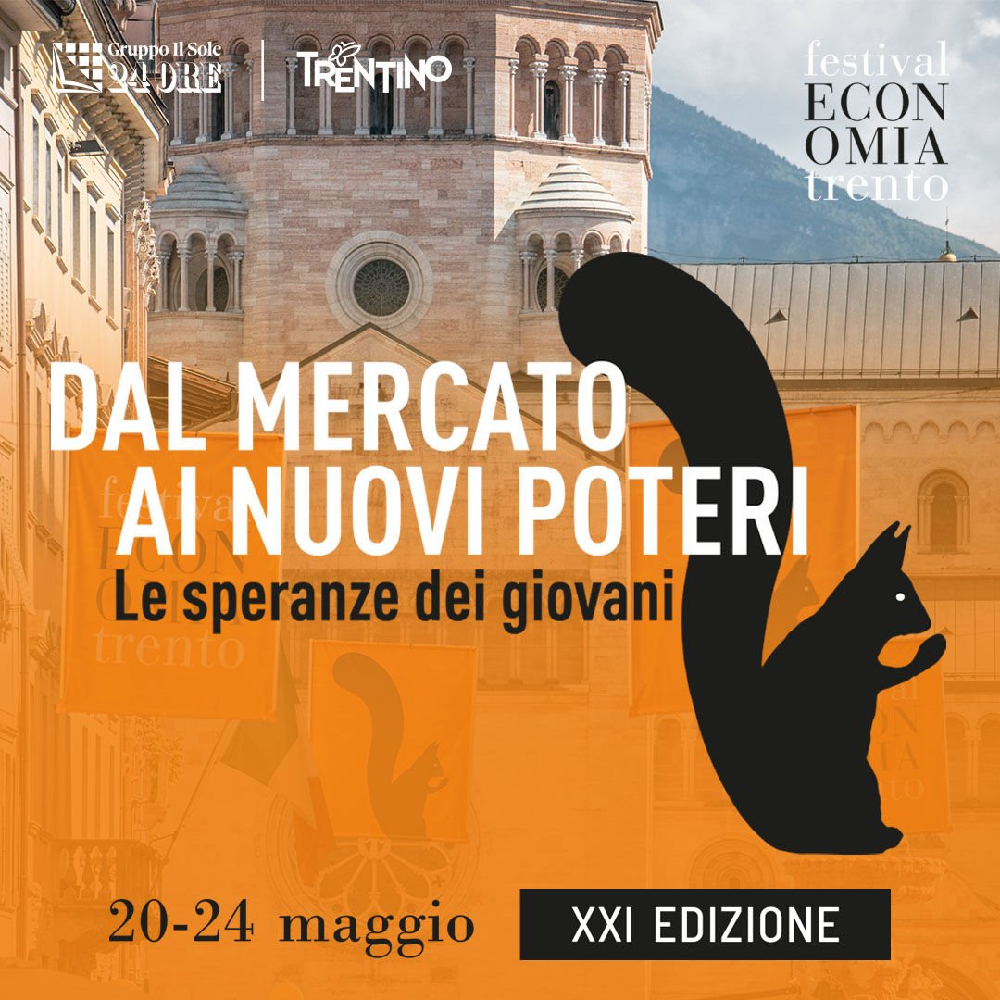
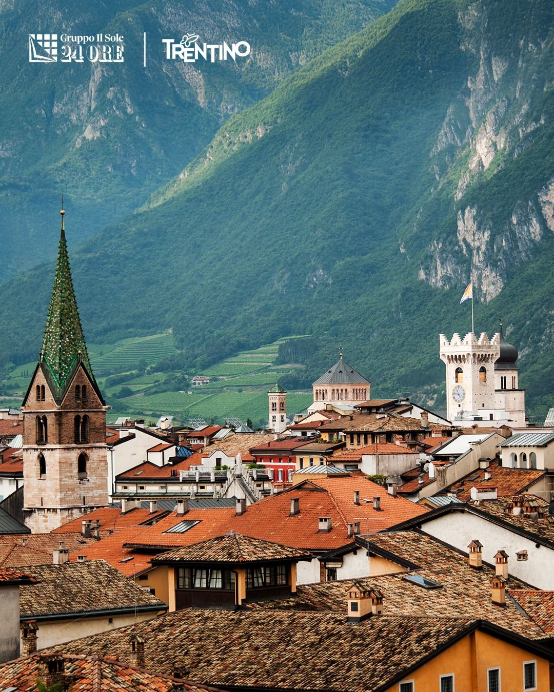

Last Friday I was in Trento for the Festival dell'Economia, organised by Il Sole 24 Ore, where I spoke on a panel called "Un futuro perfettamente prevedibile" (*A perfectly predictable future*) with Luca De Biase, journalist at Il Sole 24 Ore, and Ersilia Vaudo of the European Space Agency.

My role was to bring a humanistic perspective to the debate on large language models. I talked about how NLP and the humanities can work together, and about why the tech industry increasingly needs hybrid professionals: people who can read a text closely and also understand what a model does with it. This is where most of my own research sits, so I was glad to talk about it outside an NLP conference, to a general audience and with most of the jargon left out.

The theme of this year's festival, the 21st edition, was *Dal mercato ai nuovi poteri. Le speranze dei giovani* (From the market to the new powers: the hopes of young people).

Thanks to the organisers for the invitation, to Luca and Ersilia for the conversation, and to everyone who came to Sala Nones! The panel was in Italian, and you can watch it on demand from the [festival website](https://www.festivaleconomia.it/it/programma/programma-2026/festival/un-futuro-perfettamente-prevedibile).

## Photos

