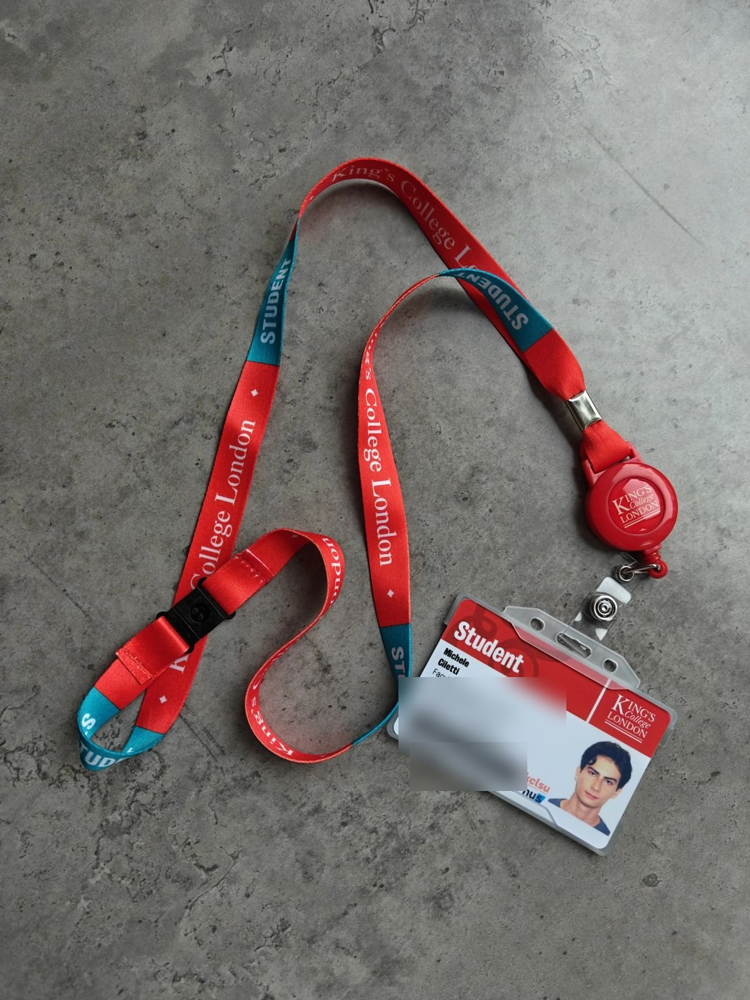
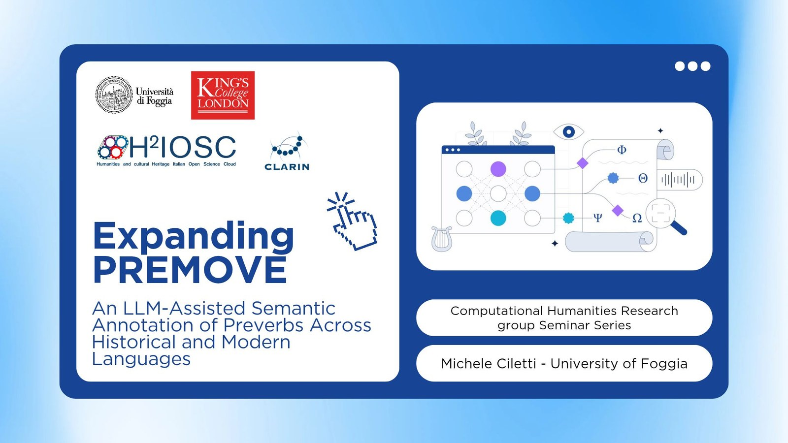
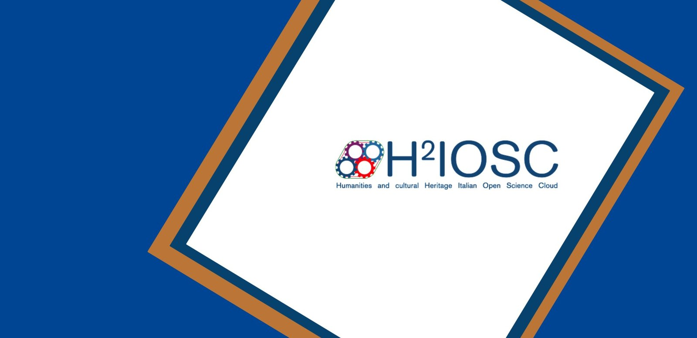

Yesterday I completed my visiting research stay at the Department of Digital Humanities of King's College London, funded by an H2IOSC Transnational Mobility Grant! H2IOSC (Humanities and cultural Heritage Italian Open Science Cloud) and CLARIN supported the project, and Barbara McGillivray and Andrea Farina hosted me.

The goal of the visit was to build a semi-automatic semantic annotation pipeline for verbs of perception in Latin and Ancient Greek, and to test the same methods on Italian. The starting point was PREMOVE, Andrea's diachronic dataset of preverbed motion verbs in the two classical languages (Farina, 2025). We are expanding it in two directions, with perception verbs in Latin and Ancient Greek and with motion verbs in Italian, so that the meaning of preverbs can be compared across verb classes and between historical languages and one of their modern descendants. An LLM proposes candidate labels, using few-shot prompting, style control and chain-of-thought reasoning, and human experts validate them.

These weeks were full. I spoke at the [Quantitative Diachronic Linguistics and Cultural Analytics](https://www.kcl.ac.uk/events/quantitative-diachronic-linguistics-and-cultural-analytics-data-driven-insights-into-language-and-cultural-change) conference on 15-16 January, with a talk titled "A GraphRAG Approach to the Quantitative Analysis of Latin Rhetoric", and on the 20th I gave a [seminar](/event/kcl-premove-seminar/) for the Computational Humanities Research Group about the PREMOVE expansion (the recording is [on YouTube](https://youtu.be/elM87pXOjSk)). In between, I annotated many tokens, fine-tuned a couple of LLMs, developed new training resources on semantic annotation, and met many awesome people.

The project will produce new open data, which will be integrated into existing knowledge bases, and a training resource on how to integrate LLMs in linguistic research. Many thanks to Barbara and Andrea, and to H2IOSC and its funders for supporting this work. Hope to be back soon!

## Photos

